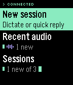
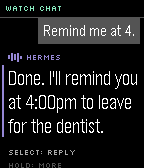
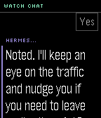
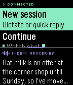
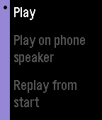
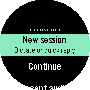
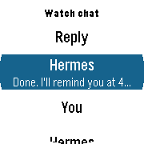
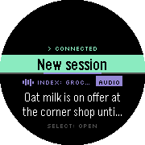
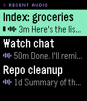
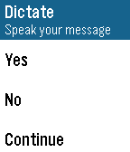

<p align="center">
  
</p>

<h1 align="center">Hermes Wristbound</h1>

<p align="center"><b>Your <a href="https://github.com/NousResearch/hermes-agent">Hermes Agent</a>, on your wrist.</b><br>
Talk to Hermes from a Pebble watch or the Index ring, read and hear its replies, and answer it, without taking your phone out.</p>

<p align="center">
  <a href="https://apps.repebble.com/22984baa50dd4b68ba9a0945">Watch app</a> ·
  <a href="https://apps.repebble.com/77caeb14dc3f4d3c8367ab82">Index plugin</a> ·
  <a href="https://github.com/AndreasThinks/hermes-wristbound/releases/latest">Android companion</a> ·
  <a href="docs/INSTALL.md">Install guide</a> ·
  <a href="https://andreasthinks.github.io/hermes-wristbound/">Website</a>
</p>

Hermes Wristbound is one product in three parts. Each works on its own, and they are built to work together against your own Hermes.

| Part | Lives on | What it does |
|------|----------|--------------|
| **[Watch app](docs/FEATURES.md)** with its Android companion (`watch/`, `android/`) | Pebble + Android phone | The full Hermes client on the wrist: browse sessions, read conversations as they stream in, reply by dictation or quick reply, approve steps, and play Hermes' audio on headphones, the phone or the watch speaker. |
| **[Index plugin](pebble-plugin/README.md)** (`pebble-plugin/`) | Pebble phone app (Android and iOS) | Makes Hermes an agent for the Index ring and any plugin-aware app: say "Tell Hermes …" and the message goes straight to Hermes. Optional *Reply with voice*. |
| **[Voice plugin](hermes-plugin/README.md)** `wristbound-voice` (`hermes-plugin/`) | Your Hermes host | Speaks the reply to a message you dictated, with your own Hermes TTS, and keeps the clip so the watch can play it. No modified Hermes needed. |

Together: you say *"Tell Hermes to …"* to Index, the Index plugin sends it, the voice plugin speaks the answer, and the watch buzzes once with **Play**.

<p>
  
  
  
  
  
</p>
<p>
  
  
  
  
  
</p>

*Basalt (Pebble Time) and Chalk (Pebble Time Round) emulators, driven by the scripted phone in `watch/tools/fake_phone.py`; the conversation is canned.*

## How the parts fit

```text
                    ┌──────────────── Your Hermes host ────────────────┐
                    │  Hermes dashboard (:9119, over Tailscale)        │
                    │    └─ wristbound-voice plugin  (hermes-plugin/)  │
                    └───────▲───────────────────────────────▲──────────┘
       HTTPS + WebSocket    │                               │  HTTPS + WebSocket
                    ┌───────┴────────────┐       ┌──────────┴──────────────┐
                    │ Wristbound         │       │ Index plugin            │
                    │ companion (Android)│       │ (inside the Pebble app) │
                    └───────▲────────────┘       └──────────▲──────────────┘
          AppMessage over   │                               │ "Tell Hermes …"
          Bluetooth         │                               │
                    ┌───────┴────────────┐       ┌──────────┴──────────────┐
                    │ Wristbound         │       │ Index ring, or any      │
                    │ watch app (Pebble) │       │ plugin-aware app        │
                    └────────────────────┘       └─────────────────────────┘
```

Hermes stays in charge of every session, turn and audio file; Wristbound keeps no conversation store of its own. The phone talks to Hermes the way the Hermes desktop app does, so the watch can continue Telegram, desktop and CLI sessions and play the audio Hermes made. The watch never holds credentials. More in [Architecture](docs/ARCHITECTURE.md).

## Pick your setup

| You want | Install |
|----------|---------|
| Hermes on the watch: sessions, replies, audio, approvals | Watch app + Android companion |
| To talk to Hermes from Index (Android or iOS) | Index plugin |
| Spoken answers to what you say to Index, played from the wrist | All three |

The [install guide](docs/INSTALL.md) walks through each, starting with making your Hermes dashboard reachable from your phone.

## Look and feel

Every part shares one look, **Phosphor**: black glass, **green `#00FFAA`** for anything you can act on, **violet `#AA55FF`** whenever Hermes is speaking, and a pixel font (Silkscreen) for fixed labels while Hermes' own words stay readable. Each kind of event has its own vibration, so the wrist alone tells a text reply from an audio reply from something that needs you. The [visual guide](docs/BRAND.md) has the full palette, type, marks and haptics.

## Status

**Experimental.** Current versions in this repository: watch app 0.6.8, Android companion 0.6.12, Index plugin 0.1.7, voice plugin 0.1.1. Session browsing, replies and phone/headphone playback have been used on a Pixel 9a with Hermes 0.22.2 and a Pebble Time 2; the Index plugin has been used on a Pixel with Index. Newer paths (native notification actions, live updates, voice replies, watch-speaker playback) pass automated and emulator tests and still need hardware checks, listed in [Testing](docs/TESTING.md). The companion is a sideloaded APK, not a Play Store app, and there is no iOS companion. Release notes are in [docs/](docs/); [Releasing](docs/RELEASING.md) covers how a GitHub release builds and publishes every part.

## Develop

```bash
cd watch && pebble build                                   # watch app, all seven Pebble platforms
cd android && ./gradlew testDebugUnitTest assembleDebug    # Android companion (JDK 21, SDK 37)
cd pebble-plugin && node --test test/*.test.js && pebble build   # Index plugin
cd hermes-plugin && pip install pytest fastapi httpx && python -m pytest tests   # voice plugin
```

CI runs all four on every pull request and attaches the `.pbw` files and the debug APK as artifacts. The [website](site/) deploys from `main`. To click through the watch UI without a phone or Hermes, see [Testing](docs/TESTING.md).

| Path | What's there |
|------|--------------|
| `watch/` | Pebble watch app (C): `ui.c`, `comm.c`, `model.c`, `theme.c` (Phosphor), `tools/fake_phone.py` |
| `android/` | Android companion (Kotlin): `hermes/` sign-in and gateway, `core/` turns and alerts, `pebble/` watch link, `playback/`, `sync/`, `notify/`, `ui/` |
| `pebble-plugin/` | Index plugin (JavaScript) |
| `hermes-plugin/wristbound-voice/` | Voice plugin (Python) |
| `site/` | The website |
| `docs/` | Guides, design notes and release notes |

## Documentation

- [Install guide](docs/INSTALL.md): all three parts, secure dashboard setup, audio, Quick Launch, troubleshooting.
- [Features](docs/FEATURES.md): everything the watch app and companion do, and known limits.
- [Visual guide](docs/BRAND.md): name, colour, type, marks, haptics.
- [Architecture](docs/ARCHITECTURE.md) · [Hermes API findings](docs/HERMES_API.md) · [Watch ↔ phone protocol](docs/PROTOCOL.md)
- [Testing](docs/TESTING.md) · [Milestones](docs/MILESTONES.md) · [Project brief](docs/PROJECT.md)

## Not in scope

Replacing Hermes, rebuilding Telegram, changing Ringbearer's working ingress, or keeping a separate conversation store. No hosted service, public Internet exposure or generic notification scraping is involved.

## License

No license has been selected yet. Public visibility does not grant an open-source license.
