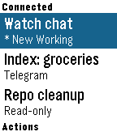
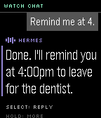
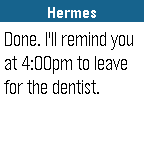
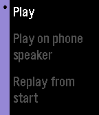
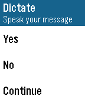
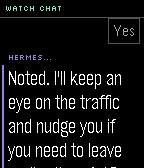
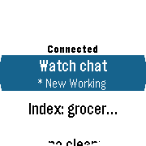
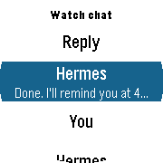

# Hermes Wristbound

A Pebble watchapp and Android companion for using [Hermes Agent](https://github.com/NousResearch/hermes-agent) without taking your phone out: browse sessions, read replies, answer by dictation or quick reply, and play replies through your headphones, all from the wrist.

**Status: first vertical slice built, not yet tested on real devices.** The watchapp builds for every Pebble platform and runs in the emulator against a scripted phone; the Android companion builds and passes its unit tests. Nothing has been run against a real Hermes, phone or watch yet; see [docs/TESTING.md](docs/TESTING.md).

<p>
  
  
  
  
  
  
</p>

<p>
  
  
  
</p>

*Basalt (Pebble Time) and Chalk (Pebble Time Round) emulators, driven by the scripted phone in `watch/tools/fake_phone.py`; the conversation is canned.*

## How it works

```text
Pebble watchapp  (watch/, C)
       | AppMessage over Bluetooth, see docs/PROTOCOL.md
Android companion  (android/, Kotlin)
       | Hermes dashboard over HTTPS + gateway WebSocket, over Tailscale
Hermes  (authoritative sessions, turns, audio)

Pebble Index -> Ringbearer -> Telegram -> Hermes session  (unchanged; Wristbound reads and plays it)
```

The phone talks to Hermes the way the Hermes desktop app and Hermes-Relay do: it signs in to the dashboard and runs turns over the dashboard's gateway socket. That is what lets the watch continue Telegram, desktop and CLI sessions and play the audio Hermes generated, rather than starting separate API sessions. The watch never holds credentials; it only shows what the phone sends it. Telegram is not needed as a client or a player.

## Features

### On the watch

- **Sessions:** recent sessions with unread, Telegram, working and read-only labels; a Telegram show/hide toggle; New session; Refresh (or long-press). The last session is remembered across launches.
- **History:** recent messages, newest first, and a full-screen view for each reply.
- **Reply:** dictation where the watch has a microphone, or a quick reply (Yes, No, Continue, Thanks, Stop, Summarise that). Each send shows queued, working, completed, failed, uncertain or read-only.
- **Playback** of one exact reply: Play, Play on phone speaker, Pause, Resume, Replay from start, Stop.
- **Alerts:** an incoming-reply alert when the app is open, with Play, Open session and Dismiss.
- Clear connection states: connected, offline with cached data, stale, not set up, sign-in failed.

### On the phone

- Signs in to the Hermes dashboard over your tailnet with a password, a browser sign-in, or the loopback session token. Credentials are stored encrypted, and tokens refresh on their own.
- Runs turns over Hermes' gateway socket with at-most-once submission: if a connection drops after sending, it looks for the answer in the transcript or re-attaches to the running turn, and reports *uncertain* rather than sending twice.
- Delivers replies to the open watchapp, or as one phone notification mirrored to the Pebble with Play, Play on speaker and Read on watch actions.
- Optional background sync picks up replies that arrive through Telegram, Ringbearer or the desktop while the watchapp is closed and the phone is locked.
- Plays a reply on the current audio route: Hermes' own audio for that reply, otherwise the reply read again in Hermes' configured voice, otherwise the phone's voice. Playback pauses when headphones disconnect instead of switching to the speaker; speaker playback is always explicit.
- One alert policy for every delivery path, with separate settings for session visibility, Telegram text alerts, Telegram audio alerts, replying to Telegram sessions, tool activity and notification privacy. Polling checkpoints persist, so a failed fetch or a restart never loses or repeats an alert.
- A bounded offline cache with no stored media.

## Setup

1. **Hermes.** On the Hermes host, run the dashboard (`hermes dashboard`, port 9119) on loopback and publish it to your tailnet: `tailscale serve --bg --https=10443 http://127.0.0.1:9119`. If Hermes-Relay is already set up with `hermes-relay-tailscale enable`, this is already done; use the same address.
2. **Phone.** Install the companion APK (from CI or a local build), open Wristbound and enter the dashboard address, for example `https://hermes.tailnet-name.ts.net:10443`. Sign in with the dashboard username and password, use *Sign in with browser* for other providers, or, for a dashboard without a sign-in page, paste its session token. Wristbound tests the session list and the gateway socket and reports how many Telegram sessions it sees.
3. **Watch.** Install `watch.pbw` through the Pebble app. Both the debug (`dev.wristbound.companion.debug`) and release (`dev.wristbound.companion`) packages are listed as companion apps.
4. **Optional.** Turn on *Watch for replies in background* to get replies while the watchapp is closed and the phone is locked.

Every pull request builds both: the watch `.pbw` and the debug APK are attached to the CI run as artifacts (`watch-pbw`, `companion-debug-apk`).

## Known gaps

- **Replies from other surfaces are polled**, not pushed (every 30 s to 5 min, while background sync is on).
- **Tool approvals and clarifications** that Hermes asks for mid-turn must be answered from another client; the watch shows that the turn is waiting.
- A watch reply in a Telegram session is stored in that session, as a desktop reply is; it is not posted into the Telegram chat. Replies to Telegram sessions can be turned off.
- **Telegram's automatic voice replies** (voice mode) are sent to Telegram and deleted by Hermes without a transcript record, so no client can play the original; Wristbound can only read that reply aloud again. Audio from Hermes' text-to-speech tool is kept and plays as is.
- No playback on the watch's own speaker yet, and no autoplay.

Details are in [docs/HERMES_API.md](docs/HERMES_API.md).

## Development

```bash
# Watchapp (needs pebble-tool: `uv tool install pebble-tool && pebble sdk install latest`)
cd watch && pebble build            # -> watch/build/watch.pbw, for aplite, basalt, chalk, diorite, emery, flint and gabbro

# Android companion (JDK 21, Android SDK platform 37; PebbleKit Android 2 requires compileSdk 37)
cd android && ./gradlew testDebugUnitTest assembleDebug   # -> android/app/build/outputs/apk/debug/
```

CI runs both on every pull request (`.github/workflows/build.yml`). To click through the watch UI without a phone or Hermes, run it in the emulator against `watch/tools/fake_phone.py`; [docs/TESTING.md](docs/TESTING.md) has the steps, including how the screenshots above were taken.

### Layout

| Path | What's there |
|------|--------------|
| `watch/src/c/` | Watchapp: `ui.c` (windows and menus), `comm.c` (AppMessage), `model.c` (on-screen state), `protocol.h` (keys and codes) |
| `watch/tools/fake_phone.py` | Scripted phone for the emulator |
| `android/.../hermes/` | Dashboard sign-in, HTTP client and gateway socket |
| `android/.../core/` | Turn runner, session mapping, alert policy, settings, local state |
| `android/.../pebble/` | Watch link, protocol codec and text fitting |
| `android/.../playback/` | Reply playback and speech chunking |
| `android/.../sync/`, `notify/`, `ui/` | Background sync, notifications and actions, settings screen |

## Documentation

- [Project brief](docs/PROJECT.md): goal, watch experience and scope.
- [Architecture](docs/ARCHITECTURE.md): components as built, data, reliability and privacy.
- [Hermes API findings](docs/HERMES_API.md): the dashboard routes and gateway calls Wristbound uses, sign-in, audio and remaining limits.
- [Watch ↔ phone protocol](docs/PROTOCOL.md): AppMessage keys, commands and rules.
- [Testing](docs/TESTING.md): automated checks, the emulator harness and the real-device plan.
- [Milestones](docs/MILESTONES.md): acceptance criteria and current status.

## Not in scope

Replacing Hermes, rebuilding Telegram, changing Ringbearer's working ingress, or keeping a separate conversation store. No hosted service, public Internet exposure or generic notification scraping is involved.

## License

No license has been selected yet. Public visibility does not grant an open-source license.
