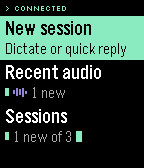
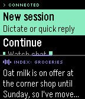
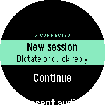
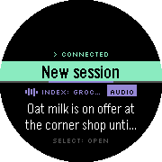

# Hermes Wristbound

A Pebble watchapp and Android companion for using [Hermes Agent](https://github.com/NousResearch/hermes-agent) without taking your phone out: browse sessions, read replies, answer by dictation or quick reply, and play replies through your headphones, all from the wrist.

**Status: experimental public release, Android v0.6.6 / watch v0.6.6.** This pair adds opt-in *Open Wristbound for alerts*: the phone opens the watchapp to show its own banner, with a native-notification fallback if startup or delivery fails. An untouched banner returns to the watchface after 15 seconds. This launch path still needs physical-watch acceptance. Android v0.6.5 also wakes the phone for the 30 s checks while the watchapp is open, keeps checking after a failed check, and adds a *Send a test alert* button. Android v0.6.4 adds alarm-driven background checking, foreground-service keep-alive for turns and phone playback, wake locks and an Allow background use setup control. Existing saved background-checking choices are preserved; new or unset preferences default on. Real-device Doze, reboot and screen-off playback acceptance remains pending. The v0.6.6 watchapp adds phone-launch splash bypass and untouched-alert expiry; protocol v5 is unchanged. Android v0.6.2 adds readable markdown-to-watch formatting; watch v0.6.1 adds bold banner headlines, an AUDIO tag and a Select hint. Both remain on protocol v5. Earlier v0.5.0 session browsing and phone/headphone playback were exercised on a Pixel 9a with Hermes 0.22.2 and a Pebble Time 2. This release adds conversation-aware native Pebble notifications with silent-phone defaults and discovery of retained automatic Hermes voice replies, including replies to Ringbearer captures. It requires the backend automatic-reply-audio extension as well as the updated Android APK. These new paths pass host regression tests but still require locked-phone, watchface-visible notification and exact-audio playback acceptance on hardware. Android may retain silent shade and background-service notifications; forwarding depends on Pebble settings and user channel overrides. Watch-speaker sound, forced phone-speaker routing with headphones attached, and hardware Quick Launch also need dedicated acceptance checks. All seven watch targets build; this does not establish hardware testing on every model. See [installation and setup](docs/INSTALL.md) and [the test plan](docs/TESTING.md).

**Android companion required.** The watch app is not standalone and does not include a hosted Hermes service. Install the watch app from the [Pebble Store](https://apps.repebble.com/22984baa50dd4b68ba9a0945), then download the matched Android APK from [GitHub Releases](https://github.com/AndreasThinks/hermes-wristbound/releases/latest) and follow the [setup guide](docs/INSTALL.md). The companion is currently a sideloaded debug APK, not a Play Store app.

<p>
  
  
  
  
  
  
  
  
  
</p>

<p>
  
  
  
  
  
</p>

*Basalt (Pebble Time) and Chalk (Pebble Time Round) emulators, driven by the scripted phone in `watch/tools/fake_phone.py`; the conversation is canned.*

### Look and feel

Wristbound's look is called *Phosphor*: black glass, green (`#00FFAA`) for anything you can act on, and violet (`#AA55FF`) whenever Hermes is speaking. Fixed labels such as section headers use a bundled pixel font (Silkscreen); Hermes' own text stays in Pebble's Gothic, so every character it sends can be shown. Audio replies carry a waveform. A reply that arrives while the app is open comes in like a radio tuning in: the waveform rises, then the text types itself out in under half a second, and any button skips to the end.

Each kind of event has its own vibration, so the wrist alone tells them apart:

| Event | Pattern | ms on / off |
|-------|---------|-------------|
| Text reply | dot | 50 |
| Reply with audio | dot dot dash | 50 · 100 · 50 · 100 · 250 |
| Needs you: failed, outcome unknown, read-only, no headphones | dash dash dash | 250 · 150 · 250 · 150 · 250 |
| Sent | double blip | 30 · 60 · 30 |
| A press that does nothing (no microphone, read-only Reply) | dot | 50 |

Black-and-white watches draw every accent in white. The original Pebble (Aplite) keeps the stock menu cells in these colours, without the waveform, the intro or the launch screen: its 24 KB is shared by code and heap, and the menus need the heap more.

## How it works

```text
Pebble watchapp  (watch/, C)
       | AppMessage over Bluetooth, see docs/PROTOCOL.md
Android companion  (android/, Kotlin)
       | Hermes dashboard over HTTPS + gateway WebSocket, over Tailscale
Hermes  (authoritative sessions, turns, audio)

Pebble Index -> Ringbearer -> Telegram -> Hermes session  (unchanged; Wristbound reads and plays it)
```

The phone talks to Hermes the way the Hermes desktop app and Hermes-Relay do: it signs in to the dashboard and runs turns over the dashboard's gateway socket. That is what lets the watch continue Telegram, desktop and CLI sessions and play the audio Hermes generated, rather than starting separate API sessions. The watch never holds credentials; it only shows what the phone sends it. Telegram is not needed as a client or a player.

## Features

### On the watch

- **Home:** New session, Continue (the last session), Recent audio and Sessions, with the connection state at the top.
- **Recent audio:** Hermes audio replies from every session, newest first, marked new until opened. Each opens as a reply card with Play, Reply and Open session, so incoming audio never needs hunting for.
- **Sessions:** recent sessions with unread, Telegram, working and read-only labels; long-press to refresh. The last session is remembered across launches.
- **Conversation:** a session opens as one scrolling conversation, your messages and Hermes' replies together, and a reply streams in as Hermes writes it. Select replies; hold Select for playback of the reply in focus, Newest and Refresh.
- **Reply:** dictation where the watch has a microphone, or a quick reply (Yes, No, Continue, Thanks, Stop, Summarise that). Each send shows queued, working, completed, failed, uncertain or read-only.
- **Playback** of one exact reply: Play on headphones (shown only while headphones are connected to the phone), Play on phone speaker (the phone's own speaker, even with headphones in), Pause, Resume, Replay from start, Stop.
- **Play on watch speaker** (Pebble Time 2 and Pebble 2 Duo): the reply's own Hermes audio, streamed from the phone and played by the watch, with buffering progress, Pause/Resume, Stop and Replay on watch. Always an explicit choice; it never falls back to the phone's speaker. Clips are capped at 2 minutes. Other watches do not show the action.
- **Quick Launch:** assign Wristbound to a Quick Launch button in the Pebble settings, then pick what it does in the companion app under *Watch → Watchapp opens on*: *Home*, *Dictate a new session* (straight into dictation for a new session), *Recent audio*, *Play latest audio* (opens and plays the newest audio reply, on headphones if connected, otherwise the phone speaker) or *Last session*. Opening the app normally always shows Home.
- **Approvals:** when Hermes asks before a step (a shell command, say) in a turn you sent from the watch, the question takes the screen with the needs-you haptic. Up and Down pick *Allow once*, *Allow session*, *Always allow* or *Deny* (Deny is picked first, so a stray press never approves), Select answers. Back puts it away; the conversation offers it again. With the watchapp closed, and on the original Pebble, it arrives as a phone notification with the answers as actions, mirrored to the Pebble.
- **Alerts:** a reply that arrives while the app is open slides up as a banner over the lower part of the screen, in Phosphor green (violet for audio), with the session and the start of the reply. A short first sentence or line is shown in bold as a headline, an audio reply carries an AUDIO tag, and the card says what Select does. Select opens the conversation at that reply; Back puts it away, and it fades after 15 s. A reply in the conversation on screen just appears there.
- Clear connection states: connected, offline with cached data, stale, not set up, sign-in failed.

### On the phone

- Signs in to the Hermes dashboard over your tailnet with a password, a browser sign-in, or the loopback session token. Credentials are stored encrypted, and tokens refresh on their own.
- Runs turns over Hermes' gateway socket with at-most-once submission: if a connection drops after sending, it looks for the answer in the transcript or re-attaches to the running turn, and reports *uncertain* rather than sending twice.
- Optionally opens Wristbound for incoming alerts (off by default); startup waits up to 10 seconds for HELLO before falling back to the native notification. Silent late-audio updates do not open the watchapp.
- Delivers replies to the open watchapp, or as one phone notification mirrored to the Pebble with Play audio, Play on phone speaker and Open in Wristbound actions. Reply notifications use a separate channel with silent phone defaults; Pebble forwarding and vibration still need device acceptance.
- Replies that arrive through Telegram, Ringbearer or the desktop are checked for while the watchapp is open (every 30 s), and with background checking (on by default) also while it is closed and the phone is locked. Alarms wake the phone for each check, and a turn sent from the watch or a reply playing on the phone keeps the companion running after the watchapp closes.
- Plays a reply on headphones or on the phone's speaker, whichever the watch picked: Hermes' own audio for that reply. Only replies that carry Hermes audio offer Play; text replies are never read aloud. Headphone playback pauses when they disconnect instead of switching to the speaker; speaker playback is always explicit and uses the phone's speaker even while headphones are connected. The watch is told whenever headphones connect or disconnect.
- Chooses which sessions the watch lists: chats on this machine always, messaging chats (Telegram, Discord, Slack…) by default, scheduled and automation sessions (cron, Kanban, webhooks, subagents) only when asked; pinned sessions first.
- One alert policy for every delivery path, decided by what a reply answers: a voice reply from any session, a reply to a message sent from the watch, a reply in a desktop or terminal chat, a text reply in a messaging chat (off by default), or background work (scheduled sessions, and Hermes following up on its own tasks; off by default). Each has its own switch, under one master switch, alongside replying to Telegram sessions, tool activity and notification privacy. Polling checkpoints persist, so a failed fetch or a restart never loses or repeats an alert.
- Bounded offline conversation/audio caches on the phone; the watch never stores dashboard credentials.

## Setup

Start with the [step-by-step installation guide](docs/INSTALL.md), including the companion APK, secure dashboard setup, audio routes, Quick Launch and troubleshooting.

1. **Hermes.** On the Hermes host, run the dashboard (`hermes dashboard`, port 9119) on loopback and publish it to your tailnet: `tailscale serve --bg --https=10443 http://127.0.0.1:9119`. If Hermes-Relay is already set up with `hermes-relay-tailscale enable`, this is already done; use the same address.
2. **Phone.** Install the companion APK (from CI or a local build), open Wristbound and enter the dashboard address, for example `https://hermes.tailnet-name.ts.net:10443`. Sign in with the dashboard username and password, use *Sign in with browser* for other providers, or, for a dashboard without a sign-in page, paste its session token (under *Advanced*). The address is checked before anything is sent, and only becomes the active dashboard once sign-in works; credentials are kept for that address alone. Once signed in, the form is replaced by an account card showing the dashboard, whether Hermes is reachable right now, *Test connection* and *Sign out*.
3. **Watch.** Install `watch.pbw` through the Pebble app. Both the debug (`dev.wristbound.companion.debug`) and release (`dev.wristbound.companion`) packages are listed as companion apps.
4. **Background.** *Keep checking in the background* is on by default, so replies reach the watch while the watchapp is closed and the phone is locked. Press *Allow background use* under *Checking for replies* so Android's battery optimisation does not hold checks back while the phone sleeps.

Every pull request builds both: the watch `.pbw` and the debug APK are attached to the CI run as artifacts (`watch-pbw`, `companion-debug-apk`).

## Known gaps

- **Replies from other surfaces are polled**, not pushed: every 30 s while the watchapp is open, and every 30 s to 5 min with background checking on. In deep Doze Android spaces the checks out further (about every 9 minutes, sooner with *Allow background use*).
- **Clarifications and password prompts** that Hermes asks for mid-turn must be answered from another client; the watch shows that the turn is waiting. Approvals are answered on the watch, but only in turns sent from the watch.
- A watch reply in a Telegram session is stored in that session, as a desktop reply is; it is not posted into the Telegram chat. Replies to Telegram sessions can be turned off.
- **Automatic voice needs the matching Hermes changes.** The companion reads retained automatic speech attached to the exact assistant reply, including ordered split files. Unmodified servers and already-deleted historical audio cannot supply it. Wristbound never synthesizes replacement speech. This unreleased implementation has local regression coverage; native notifications and routing require hardware acceptance.
- **Watch speaker playback is untested on hardware.** It works in the emulator up to the point of sound (the emulator has none). Audio is 8 kHz 8-bit to fit Bluetooth, so expect phone-call quality, and a slow link drops back to buffering mid-clip.
- Incoming replies do not autoplay. The optional **Play latest audio** Quick Launch action deliberately starts playback and may use the phone speaker when headphones are absent.

Details are in [docs/HERMES_API.md](docs/HERMES_API.md).

## Development

```bash
# Watchapp (needs pebble-tool: `uv tool install pebble-tool && pebble sdk install latest`)
cd watch && pebble build            # -> watch/build/watch.pbw, for aplite, basalt, chalk, diorite, emery, flint and gabbro

# Android companion (JDK 21, Android SDK platform 37; PebbleKit Android 2 requires compileSdk 37)
cd android && ./gradlew testDebugUnitTest assembleDebug   # -> android/app/build/outputs/apk/debug/
```

CI runs both on every pull request (`.github/workflows/build.yml`). To click through the watch UI without a phone or Hermes, run it in the emulator against `watch/tools/fake_phone.py`; [docs/TESTING.md](docs/TESTING.md) has the steps, including how the screenshots above were taken.

### Layout

| Path | What's there |
|------|--------------|
| `watch/src/c/` | Watchapp: `ui.c` (windows and menus), `comm.c` (AppMessage), `model.c` (on-screen state), `protocol.h` (keys and codes) |
| `watch/tools/fake_phone.py` | Scripted phone for the emulator |
| `android/.../hermes/` | Dashboard sign-in, HTTP client and gateway socket |
| `android/.../core/` | Turn runner, session mapping, alert policy, settings, local state |
| `android/.../pebble/` | Watch link, protocol codec and text fitting |
| `android/.../playback/` | Reply playback and speech chunking |
| `android/.../sync/`, `notify/`, `ui/` | Background sync, notifications and actions, settings screen |

## Documentation

- [Project brief](docs/PROJECT.md): goal, watch experience and scope.
- [Architecture](docs/ARCHITECTURE.md): components as built, data, reliability and privacy.
- [Hermes API findings](docs/HERMES_API.md): the dashboard routes and gateway calls Wristbound uses, sign-in, audio and remaining limits.
- [Watch ↔ phone protocol](docs/PROTOCOL.md): AppMessage keys, commands and rules.
- [Testing](docs/TESTING.md): automated checks, the emulator harness and the real-device plan.
- [Milestones](docs/MILESTONES.md): acceptance criteria and current status.

## Not in scope

Replacing Hermes, rebuilding Telegram, changing Ringbearer's working ingress, or keeping a separate conversation store. No hosted service, public Internet exposure or generic notification scraping is involved.

## License

No license has been selected yet. Public visibility does not grant an open-source license.
